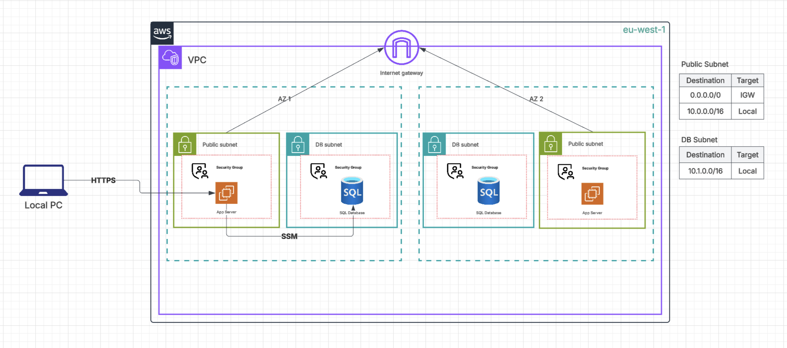

# HealthTech Infrastructure Modernisation: Reproducible AWS infrastructure with an isolated database



## The problem

HealthTech’s patient portal ran on EC2 with a publicly accessible database and infrastructure configured manually through the AWS Console. This created security risks, limited version control and auditability, and increased the likelihood of errors during infrastructure replication or recovery. Outdated documentation also made the environment harder to maintain.

## What I built

I built reproducible infrastructure using AWS CDK with TypeScript. The design uses a VPC spanning two Availability Zones, each with a public and private subnet. EC2 hosts the web application in a public subnet, while the RDS database resides in isolated private subnets.

The database security group accepts traffic only from the application’s security group. AWS Systems Manager provides administrative access without opening inbound SSH, while IAM policies control access and HTTPS protects connections to the web application.

## Decisions I made

- Chose public-subnet placement for EC2 over a private application subnet requiring a NAT gateway to avoid NAT gateway costs.
- Chose a SQL database over a NoSQL database for the patient-data use case.
- Chose AWS CDK with TypeScript over manual Console configuration to support version control, collaboration, and reproducibility.

## What broke and how I fixed it

RDS rejected MySQL version `8.0.42`. I queried the region-specific instance options, selected the available MySQL `8.0.46` version with `gp2` storage, and redeployed successfully. This taught me that a version defined in CDK is not necessarily available in the deployment region.

Session Manager initially showed the instance as disconnected. It became available without further changes after waiting, suggesting a delay in registration or permission propagation.

I learned to validate provisioning, routing, security group access, authentication, and SQL execution separately. A successful deployment does not prove that an application can connect, and a successful connection does not prove that unauthorized sources are blocked.

## Result

HealthTech’s infrastructure is now defined as reproducible, version-controlled code, reducing manual setup steps and the risk of configuration errors.

The network spans two Availability Zones, and the database is isolated with public access disabled. Restricting database access to the application’s security group strengthens network segmentation, while Session Manager enables administration without inbound SSH.

The implementation provides a foundation for auditable infrastructure changes and future compliance work. Excluding NAT gateways avoids their recurring charges.

## How to run it

Install Node.js/npm and the AWS CLI, then configure AWS credentials with appropriate deployment permissions. Replace `YOUR_ACCOUNT_ID` below with the target AWS account ID.

```bash
git clone https://github.com/AkwGaniu/legacy_to_modern_infrastructure.git
cd legacy_to_modern_infrastructure

npm ci

export AWS_REGION=eu-west-1
export AWS_DEFAULT_REGION=eu-west-1

aws sts get-caller-identity

# Required once per account/region if not already bootstrapped.
npx cdk bootstrap aws://YOUR_ACCOUNT_ID/eu-west-1

npm run build
npx cdk synth
npx cdk diff --all
npx cdk deploy --all
```

Verify that the configured MySQL version remains available before deploying. After deployment, connect to EC2 through Session Manager, retrieve the current database endpoint and credentials, and test the database connection. Enter passwords at the client prompt rather than placing them in commands.

To remove the project stacks:

```bash
npx cdk destroy --all
```

Check for retained RDS snapshots and other remaining resources after teardown. Recreating the stacks creates a new database; it does not automatically restore the previous database’s data.

**Write-up:** [How I Built Reproducible Infrastructure on AWS, and What Broke](https://medium.com/@ganiu.akowanu/how-i-built-reproducible-infrastructure-on-aws-and-what-broke-d8120b7e2008?sharedUserId=ganiu.akowanu)